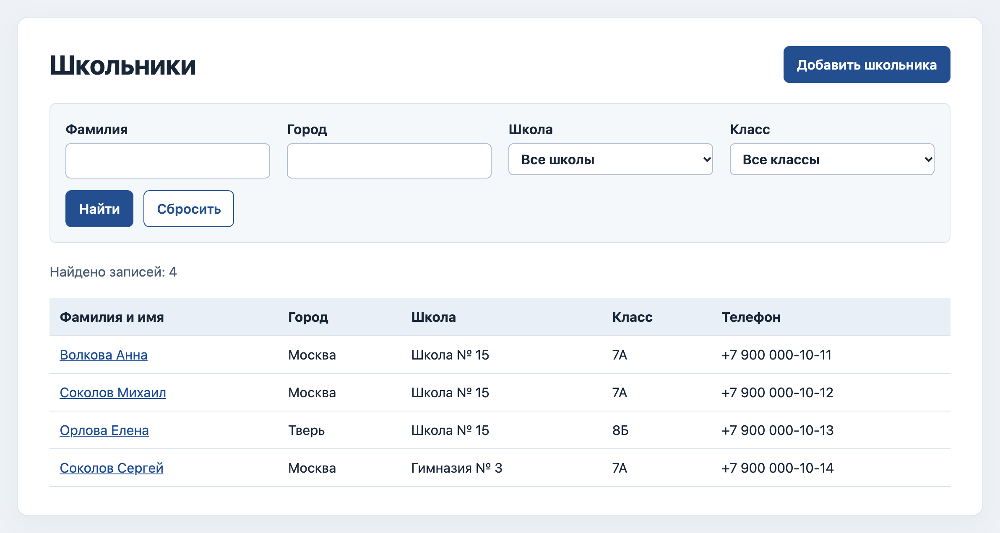
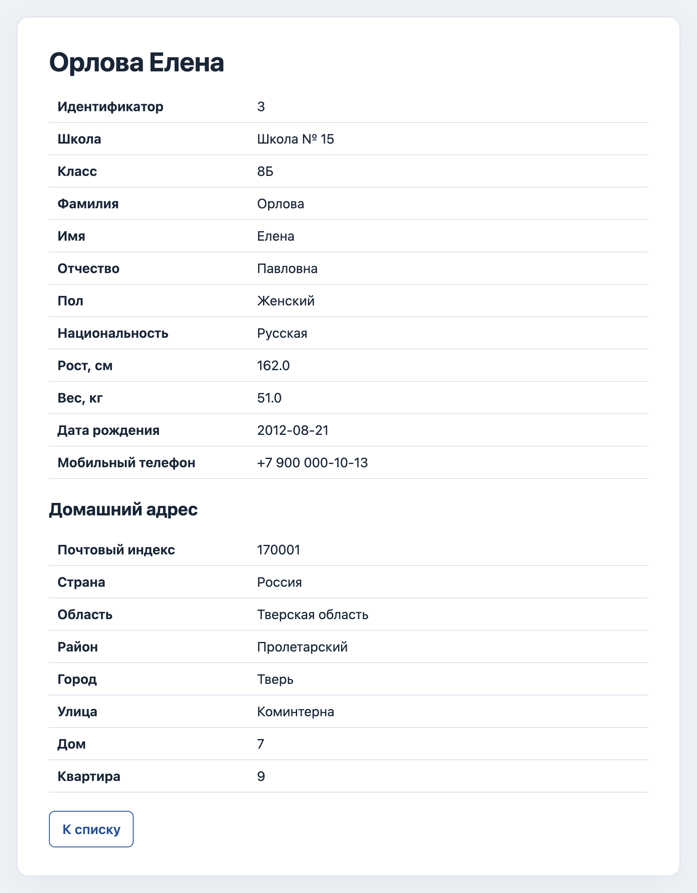

# Лабораторная работа № 3. Связи между таблицами

## Цель работы

Связать данные школьников, адресов, школ и классов для варианта 2. Реализовать просмотр, добавление и поиск школьников по сочетаниям фильтров.

## Архитектура проекта

- **Стек:** Java 17, Spring Boot 3.5.16, Maven Wrapper, Spring MVC, Thymeleaf, Spring Data JPA, Jakarta Validation.
- **СУБД:** H2 в памяти. При перезапуске восстанавливаются демонстрационные данные.
- **Основные слои:**
  - **Controller** — `SchoolboyController` обрабатывает список, карточку, фильтры и форму добавления по `/schoolboys`.
  - **Service** — `SchoolboyService` проверяет соответствие класса школе и управляет операциями с записью.
  - **Repository** — `JpaSchoolboyStore` читает и сохраняет связанные сущности и выполняет параметризованные JPQL-запросы.
  - **View** — шаблоны Thymeleaf отображают результаты и сообщения валидации.
- **Ключевые аннотации:** `@Entity`, `@OneToOne`, `@ManyToOne`, `@Transactional`, `@ModelAttribute`, `@Valid`.

## Алгоритм работы

1. Открыть список `/schoolboys` или карточку `/schoolboys/{id}`.
2. Найти школьников по фамилии и городу, по школе и классу или по городу, школе и классу. Пустые фильтры показывают полный список.
3. Открыть `/schoolboys/new` и заполнить личные данные, домашний адрес, школу и класс. Сервер проверяет поля и принадлежность класса школе, сохраняет запись и открывает её карточку.

## Скриншоты работы приложения

**Список и фильтры**

**Фильтр по городу, школе и классу**

**Карточка и связанный адрес**

**Форма добавления**

