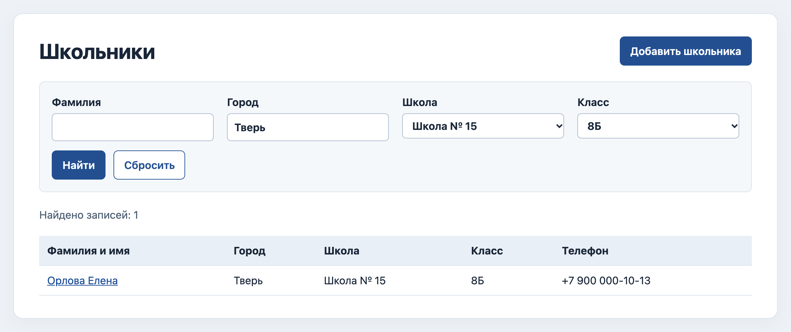
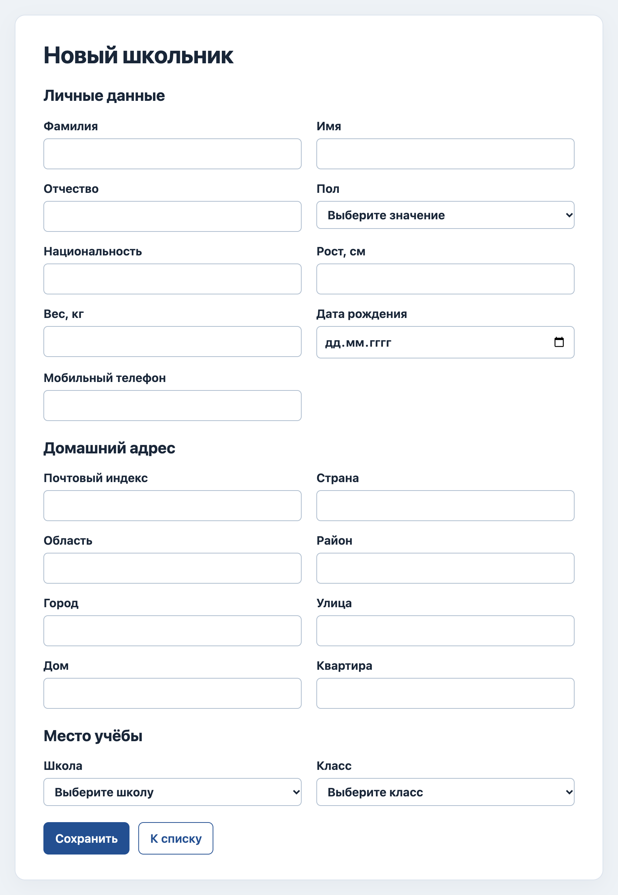

# Лабораторная работа № 3. Связи между таблицами

## Цель работы

Создать веб-приложение для варианта 2 «Школьник» со связанными данными об адресах, школах и классах.

## Архитектура проекта

Стек включает Java 17, Spring Boot 3.5.16, Maven Wrapper и Spring MVC, Thymeleaf, Spring Data JPA, H2, Jakarta Validation.

- Школьник связан с адресом отношением «один к одному» и принадлежит одному классу.
- Каждый класс принадлежит школе. В базе используются четыре таблицы с внешними ключами.
- Контроллер принимает фильтры и формы. Сервис проверяет соответствие класса школе. Репозиторий выполняет JPQL-запросы с параметрами.
- Аннотации `@Entity`, `@OneToOne`, `@ManyToOne`, `@Transactional`, `@ModelAttribute`, `@Valid`.

## Алгоритм работы

1. В списке откройте карточку школьника или выберите «Добавить школьника».
2. Заполните личные данные и домашний адрес, выберите школу и класс. После успешного сохранения откроется карточка.
3. Для поиска по фамилии и городу укажите «Соколов» и «Москва». По школе и классу выберите «Школа № 15» и «7А». Для третьей комбинации укажите «Тверь», «Школа № 15» и «8Б».
4. Пустые фильтры показывают все записи. Сервер проверяет формат полей и отклоняет неизвестный класс или несоответствие классу выбранной школы.

## Запуск в IntelliJ IDEA

1. Откройте папку с файлом `pom.xml` в IntelliJ IDEA и дождитесь импорта Maven.
2. В **File → Project Structure → Project SDK** выберите JDK 17, если среда ещё не выбрала его.
3. Выберите конфигурацию **Лабораторная 3** и нажмите **Run**. Откройте [страницу приложения](http://127.0.0.1:8083/schoolboys).

Данные H2 находятся в памяти. После перезапуска восстанавливаются демонстрационные записи.

Для проверки проекта из терминала выполните `./mvnw clean verify`.

## Скриншоты работы приложения

**Список и фильтры**

**Фильтр по городу, школе и классу**

**Карточка и связанный адрес**

**Форма добавления**

